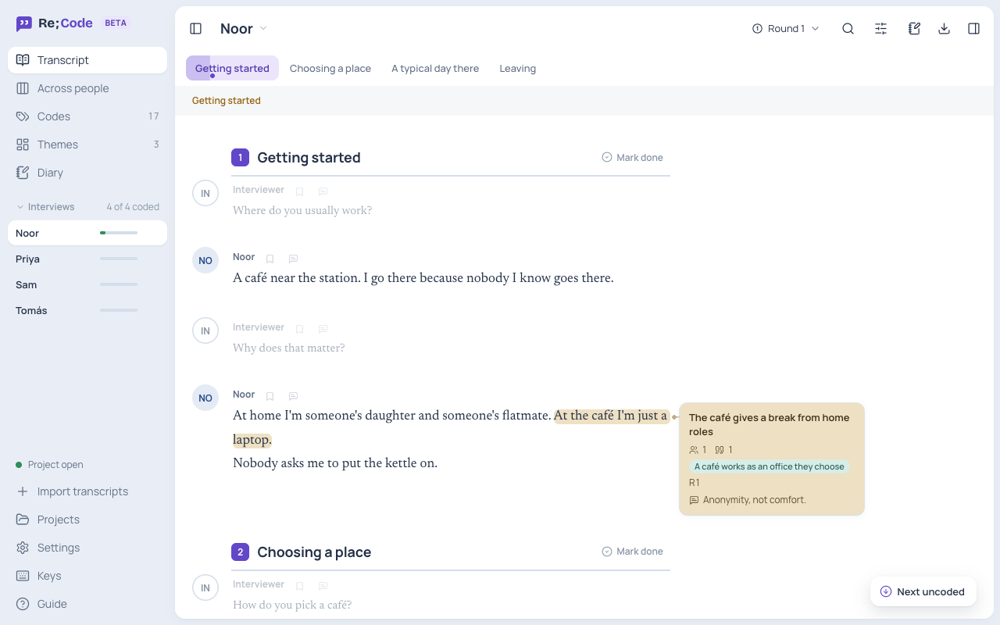
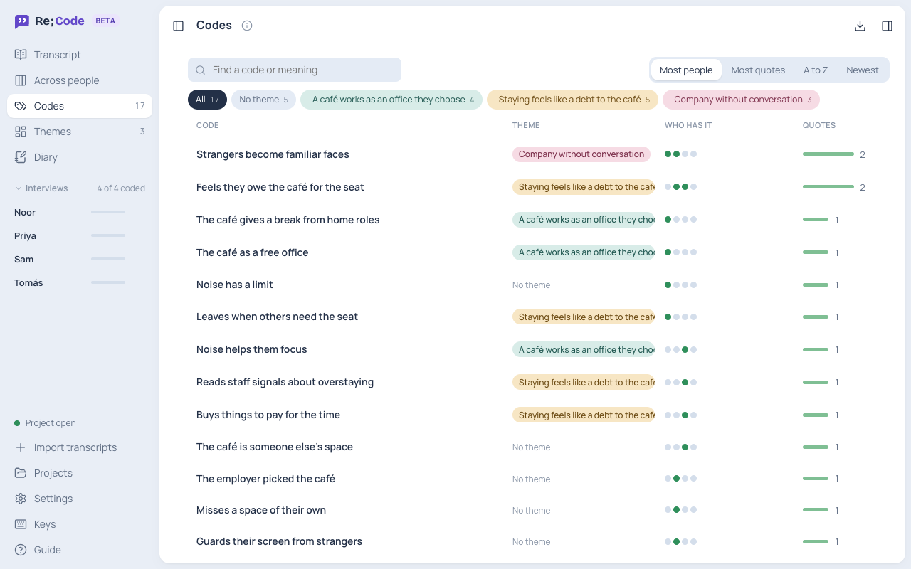
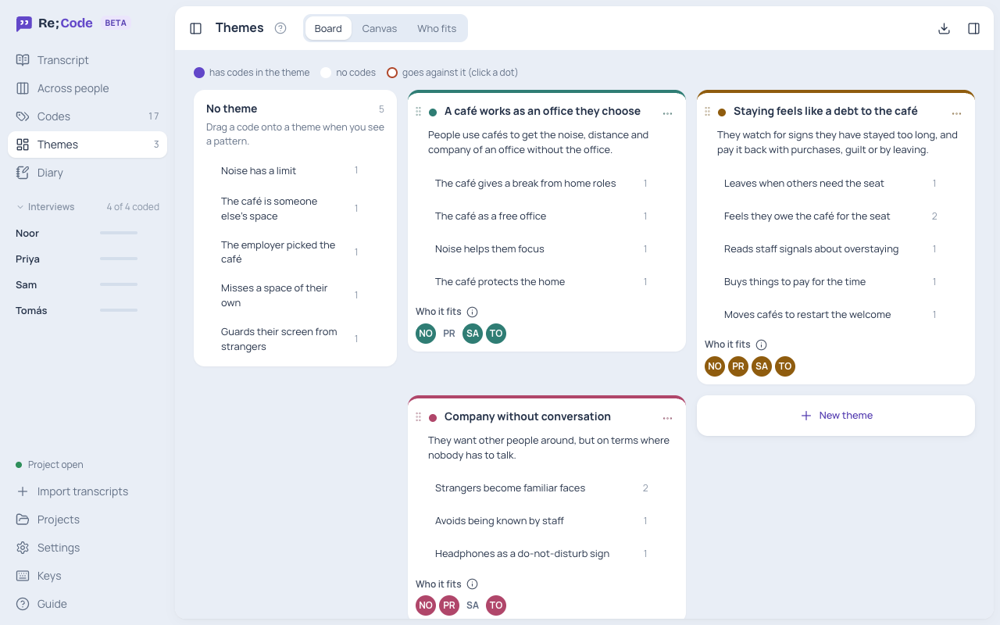
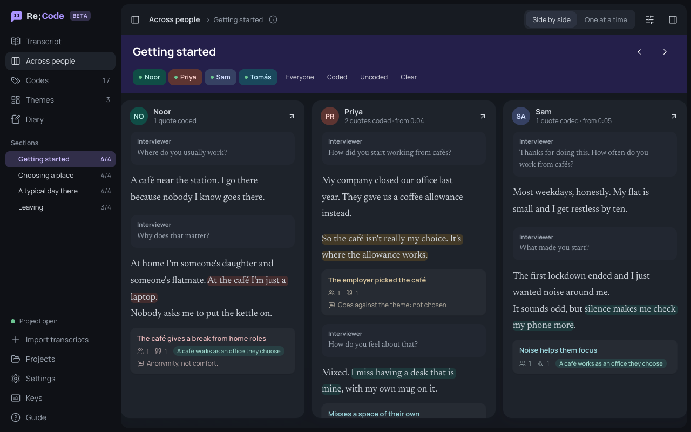

# Re;Code

Re;Code is a free desktop app for reflexive thematic analysis of interview transcripts. You read, code and build themes in one place, with the audio right beside the text. It runs on Mac and Windows and is still in beta.



We built it for our own convenience while coding the interviews from a study.

- Import transcripts from Word, text, Markdown, or Zoom, Teams and Otter files.
- Code in rounds. Codes sit next to their quotes.
- Group codes into themes and see who each theme fits.
- Read one part of the interview across everyone, side by side.
- Keep a diary as you go.
- Link the audio and click a timestamp to play it.
- Export to CSV.

No account. Your files stay on your computer.





## Download

Get it from [Releases](../../releases). On a Mac, pick `aarch64.dmg` for M1 and later, or `x64.dmg` for older Intel Macs. On Windows, pick the `.msi` or `.exe`.

The app isn't signed yet, so you'll get a warning the first time. On a Mac, go to System Settings → Privacy & Security and click **Open Anyway**. On Windows, click **More info**, then **Run anyway**.

Click **Try the sample** to look around first.

## Transcripts

```
## Getting started
[0:05] Interviewer: How often do you work from cafés?
[0:11] Sam: Most weekdays.
```

`##` starts a section. Times are optional. More in [docs/transcript-format.md](docs/transcript-format.md).

## Build it yourself

You need Node.js, Python 3 and [Rust](https://rustup.rs).

```
npm install
npm run build
```

## Coming later

Working on one project together, NVivo and ATLAS.ti import and export, PDF import, and hiding names.

See also [Re;Guide](https://github.com/azmainmahdi/re-guide), for running the interviews.

MIT licence. Fonts and icons are listed in [THIRD-PARTY.md](THIRD-PARTY.md).
